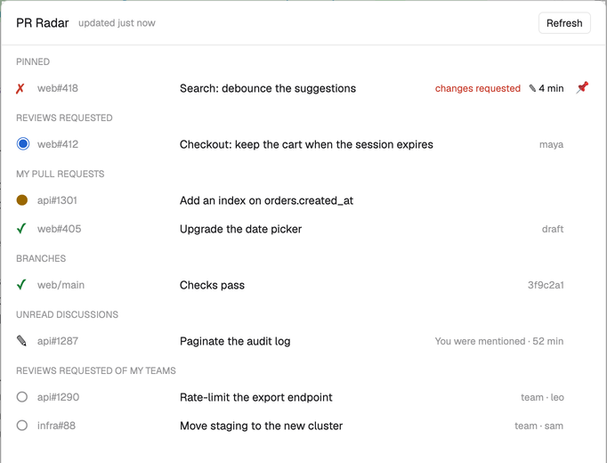
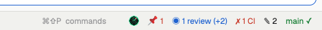

# PR Radar

A [Herdr](https://herdr.dev) mod that tells you when GitHub needs you, without leaving your terminals:
review requests, red CI on your pull requests, broken branches and new comments in discussions you
take part in. It sits in your status bar as a small badge, posts a Herdr toast when something
changes, and opens a panel with everything waiting on you.





## What it tells you

| When | Toast | Sound (default) |
|---|---|---|
| Your review is requested by name | warning | yes |
| A check fails on one of your open pull requests | error | yes |
| Your pull request's checks pass after running or failing | success | no |
| A watched branch breaks | error | yes |
| A watched branch is fixed | success | no |
| New activity in a pull request discussion you take part in | info | no |

Reviews requested of your teams are listed in the panel but not announced, unless you set
`teamReviews`. Clicking a toast or a row opens it in your browser. The first check after a start only
records what's there, so you aren't flooded with old news.

## Pinning

Hover a row in the panel and click the 📌 that appears at its end to pin that pull request. Pinned pull requests get
their own section at the top of the panel, one row each with everything known about it (review
requested, CI, review decision, unread discussion), and a `📌 2` in the badge (red when one's CI
fails, accent when one waits on you).

A pinned pull request is loud: everything about it is announced, with the sound (unless `sound`
is `"never"`):

| When | Toast |
|---|---|
| Its checks fail, or pass after running or failing | error / success |
| It's approved, or changes are requested | success / warning |
| Someone pushes new commits to it (not on your own) | info |
| Someone comments or reviews (not you, not a bot) | info |
| A review is requested of your team on it | warning |
| It's merged or closed: it's then unpinned | success / info |

A pin works on any pull request, even one that's in none of your lists. Pins are kept per
configuration, across restarts. Click its 📌 again to unpin.

## Requirements

- Herdr (the desktop app).
- The [GitHub CLI](https://cli.github.com), logged in: `gh auth status`. PR Radar uses your own
  login and nothing else: no token to paste, no server in between.

## Install

1. Copy `mods/pr-radar` to `~/.config/herdr-app/mods/pr-radar`. Copy `mod.json` along with the
   rest (it keeps Herdr from docking a copy by itself).
2. Add a block for it to your layout. Herdr's shipped layouts belong to Herdr: first make your own
   copy with the `layout.clone` command. Then, in `~/.config/herdr-app/layouts/<yours>.json`,
   replace the status bar block

   ```json
   { "id": "status", "type": "block", "size": { "px": 28 }, "content": { "mod": "workspace-status" } }
   ```

   with a row that holds it and PR Radar:

   ```json
   { "id": "status-row", "type": "row", "size": { "px": 28 }, "resizable": false, "children": [
       { "id": "status", "type": "block", "content": { "mod": "workspace-status" } },
       { "id": "pr-radar", "type": "block", "size": { "px": 300 },
         "content": { "mod": "pr-radar", "props": { "orgs": ["my-org"] } } } ] }
   ```

3. Check it: `herdr-app check ~/.config/herdr-app/mods/pr-radar`, then
   `herdr-app do pr-radar.test` to see a sample toast.

## Configure

Everything goes in the block's `props`, and every field is optional. With no props at all,
PR Radar watches every repository you're involved in.

| Prop | Default | What it does |
|---|---|---|
| `orgs` | `[]` | Only pull requests in these orgs (or users) |
| `repos` | `[]` | …and in these repositories (`"owner/name"`). With both empty: everywhere |
| `branches` | `[]` | Branches whose checks to watch: `"owner/name@branch"` |
| `host` | `"github.com"` | A GitHub Enterprise host, as `gh` knows it |
| `interval` | `60` | Seconds between checks (30 at least) |
| `sound` | `"needs-you"` | `"needs-you"` (review requested, red CI, broken branch), `"always"` or `"never"` |
| `teamReviews` | `false` | Also announce reviews requested of your teams |
| `greenCi` | `true` | Announce your pull request's checks passing |
| `lang` | `"en"` | `"en"` or `"fr"` |
| `demo` | `false` | Made-up data and no network, for screenshots |

```json
"props": {
  "orgs": ["my-org"],
  "branches": ["my-org/app@main", "my-org/api@main"],
  "sound": "needs-you"
}
```

## Commands

- `pr-radar.panel` opens the panel. Bind it in `keys.json`, e.g. `"cmd-shift-g": "pr-radar.panel"` in its `global` section.
- `pr-radar.refresh` checks now.
- `pr-radar.test` posts a sample toast.

Run them with `herdr-app do <command>`.

## What it runs and reads

PR Radar runs `gh` on your machine, with your GitHub login:
- one GraphQL query per check, for your pull requests, review requests, watched branches and pinned
  pull requests;
- one call to the notifications API, for discussions.

It also runs `open` (macOS) or `xdg-open` (Linux) to open links. It keeps a small state in Herdr's
shared state, and sends nothing anywhere else.

## License

MIT
