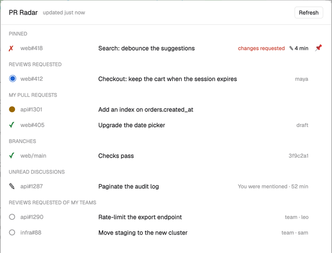

# PR Radar

A badge in Herdr's status bar that watches GitHub for you: how many reviews wait on you, whether
your pull requests' checks pass, whether the branches you care about are green, and how many
discussions have news. When one of these changes, a Herdr toast says so (with a sound for what needs
you), and a click on the badge opens a panel listing it all, each row a link to GitHub.

## What you see

- **The badge**: a block 300 px wide, 28 px high, at the right end of the status bar, after
  `workspace-status`. Theme `chrome` background, a 1 px `border` line on top, text at 11.8 px in
  `muted`, everything packed against the right end with a 12 px gap, starting with the icon (15 px):
  - `◉ 1 review (+2)`: reviews requested of you by name, then of your teams in brackets. In
    `accent` when at least one is yours.
  - `✗ 1 CI` in `blocked` when one of your open pull requests has failed checks; `● 2 CI` in
    `working` while some are running; `✓ CI` in `muted` otherwise.
  - `✎ 2`: unread discussions, in `foreground` when there are some.
  - `main ✓`: the watched branch and its state (`✓` in `ansi2`, `✗` in `blocked`, `●` in
    `working`, `?` in `dim` when not found). With several branches: `3 branches` and the worst
    state. Hidden with none.
  - `GitHub…` in `dim` before the first answer; `⚠ GitHub` in `blocked` after an error.
- **The panel**: a dialog 680 px wide, 70% of the window high. Header: the icon (20 px), `PR Radar`, `updated 2 min ago`
  in `dim`, a `Refresh` button. A red line with the last error under it, if any. Then the sections,
  each a small uppercase `dim` title and 30 px rows (an icon, `repo#number` in `dim` 150 px wide,
  the title, a right-aligned note): Reviews requested, My pull requests (failed first),
  Branches (only when some are watched; the short commit as the note), Unread discussions (the
  reason and how long ago as the note), Reviews requested of my teams (`○` in `dim`). A draft pull
  request's row, in any section, has a `draft` tag before its title (10 px, `dim`, a 1 px `border`
  outline, 4 px corners) and its title in `muted` instead of `foreground`.
- **Pins**: each pull request row ends with a 20 px slot for a `📌` (12 px). Unpinned, it shows only
  while the row is hovered, at 35% opacity and full when the pin itself is hovered; pinned, it's
  always there at full opacity (60% on hover). A click pins or unpins without opening the row. Pinned pull requests leave their sections for a
  `Pinned` section at the top (failed first), one row each: the CI icon, then notes `◉ review`
  (`accent`) or `○ team`, `approved` (`ansi2`) / `changes requested` (`blocked`), `✎ 4 min`.
  The badge starts with `📌 2`: `blocked` when a pinned one's CI fails, `accent` when one has your
  review requested or an unread discussion, `muted` otherwise; hidden with no pins.
- **The icon** (`icon.svg`, a 40×40 view box): a radar. A dark disc (`#0F1A17`, r 18) whose edge is a
  thick green ring (`#3DDC97`, 2.6 wide), two faint inner rings (r 12 and 6, 35%), and a sweep line
  from the center to the top right (45°) with two fading wedges trailing it counterclockwise. A loose
  cloud of about 25 small green dots (r 0.7 to 1.1): bright just behind the sweep, fading the
  further round they are. One red dot (`#FF5A5F`, r 2, with a 35% halo) sits just behind the line:
  the issue it has just spotted. The same file is the README title's icon.
- **Toasts**: Herdr's own, through `notify` with an `icon`, which the `toast` mod draws (18 px) in
  place of its colored level dot. So the level is in the icon: `icon-<level>.svg` is the radar with
  its spotted blip three times bigger (r 6 at 26,12, a 1 px dark outline, a 30% halo of r 8) and
  in the level's color:
  error `#FF5A5F`, warning `#F5A524`, success `#A3F7BF`, info `#5EB0FF`. At the plain icon's size
  the blip is 2 px in a toast and its color is lost. `Review requested: web#412` with the title and author
  (warning), `CI failed: web#418` (error), `CI passed: web#418` (success), `main is broken` /
  `main is fixed`, `New comment: api#1287` (info).

## How it behaves

- It checks at start, then every `interval` seconds (60 by default), and on `pr-radar.refresh`.
- The first check only records what's there. From then on it announces:
  - a review requested of you by name that wasn't there before (a sound); one requested of your
    team only with `teamReviews`;
  - your pull request's checks turning failed on a commit not yet announced as failed (a sound);
    turning green after running or failing (`greenCi`);
  - a watched branch whose settled state (success or failed) flips; a run in progress changes
    nothing; broken has a sound;
  - an unread participating notification on a pull request that's new or updated since last seen.
- A pinned pull request is loud: every announcement about it has the needs-you sound, and also
  its team review requests, its green CI (whatever `greenCi`), its CI when it isn't yours, its
  review decision turning approved or changes requested, new commits when it isn't yours, the last
  comment or review changing when it's not by you or a bot (unless a discussion toast just said
  so), and it being merged or closed, which unpins it. Pinning only records: nothing is announced
  for a pull request until the check after it's pinned.
- `sound`: `needs-you` plays Herdr's `blocked` sound for the announcements marked above, `always` for
  all, `never` for none.
- What was announced is kept in shared state, so restarting Herdr doesn't repeat it.
- Clicking the badge opens the panel; clicking a row opens its link in the browser and closes the
  panel. Clicking a toast opens its link. Esc closes the panel.
- Agent statuses (working, blocked, done, idle) don't affect it.

## Built from

- Layout: the status bar block becomes a `row` (28 px, `resizable: false`) holding
  `{ mod: "workspace-status" }` and `{ id: "pr-radar", size: { px: 300 }, content: { mod: "pr-radar", props } }`.
- `mods/pr-radar/`:
  - `mod.json`: `{ "place": "none", "title": "PR Radar" }`.
  - `main.js`: the view. The badge copy (layout block) polls and announces. The panel copy is
    opened with `openOverlay({ mod: "pr-radar", props: { panel: true, cfg: <badge's props> },
    kind: "dialog" })` and only reads. It also handles the `refresh`, `panel`, `test` and `open-<slot>`
    commands from `nextCommand()`.
  - `config.js`: reads the props (orgs, repos, branches, host, interval, sound, teamReviews, greenCi,
    lang, demo) into a config with defaults; its scope id keys the shared state.
  - `github.js`: `gh api graphql`, one query with three `search(type: ISSUE)` (scope `is:pr is:open
    archived:false` plus `org:` / `repo:` qualifiers: `author:@me`, `user-review-requested:@me`,
    `review-requested:@me`; the difference between the last two is your teams), each pull request's
    last commit `statusCheckRollup.state`, and one `repository { ref { target { statusCheckRollup } } }`
    alias per watched branch, and one `repository { pullRequest(number) }` alias per pin (with
    `state`, `reviewDecision` and the last `ISSUE_COMMENT` / `PULL_REQUEST_REVIEW` timeline item).
    `gh api graphql` exits 1 when part of the query fails (a pin or branch that's gone): the answer
    still counts when it has `data`, and a `NOT_FOUND` on a pin's alias unpins it. `gh api notifications?participating=true`, keeping pull requests in
    scope, without the `review_requested` and `ci_activity` reasons.
  - `icon.svg`: the icon, drawn with `image("mods/pr-radar/icon.svg")` (full color, from Herdr's
    config folder) as the badge's first child and before the panel's title.
  - `icon-error.svg`, `icon-warning.svg`, `icon-success.svg`, `icon-info.svg`: the toasts' icons,
    picked by the toast's level.
  - `i18n.js`: English and French strings. `demo.js`: made-up data for `demo: true`, starting with `acme/web#418` pinned (changes requested).
- Herdr: `exec` (gh, open), `notify` with `action: { name: "pr-radar.open-<slot>" }`, `playSound`,
  `openOverlay` / `closeOverlay`, `shared` / `setShared`, `nextCommand`, `run("pr-radar.refresh")`,
  `theme`, `props`, `cx.timer.every`; gpui-kit's `image`.

## Watch out

- Pins live in shared `pr-radar.pins:<scope>` (an array of `owner/name#123`), so the panel copy
  writes them and the badge copy reads them. A row's 📌 stops the click with
  `cx.stop_propagation()` so the row doesn't open. There's no group hover: a row's `on_hover`
  sets the panel's `hoverRow` (its id) and re-renders, and the pin's id is derived from its row's,
  so revealing it doesn't shift the ids below.
- **Never run it from a window**: an `openOverlay({ kind: "window" })` with `width: 1, height: 1`
  is the whole window, not one pixel (sizes up to 1 are shares). Invisible, kept and on top, it takes
  every click. A layout block is the place for background work: it lives while the layout shows,
  hidden or not.
- **Write `mod.json` before `main.js`**: the first time Herdr sees a mod folder, it docks a copy into
  the shown layout following `mod.json`. Without one yet, you get a second badge in a new column and
  every toast twice.
- **After a reload, the old copy still listens**: a `nextCommand()` loop of the previous build keeps
  receiving commands until it touches its own `cx`. Call `cx.notify()` right after each
  `await nextCommand()` so it ends.
- A toast's `action` is a command with no payload a mod can read, so the link goes through a slot:
  `pr-radar.open-<slot>`, looked up in the badge copy's own map.
- `review-requested:@me` includes your teams' requests (often many); `user-review-requested:@me`
  is only you.
- Search returns 50 results at most per list. Notifications: the first 50.
- A thread you read on GitHub drops out of the unread list; new activity brings it back and announces it.
- **Images and modules must really live in `~/.config/herdr-app`**: through a symlink (the mod
  folder linked to a repo, say) an `image` silently doesn't draw, though its space is kept, and
  per-file symlinks for modules fail `herdr-app check` ("resolves outside the application
  directory"). Install by copying the folder.
- **No spacer in the badge row**: it's `justify_end`, so when the items are wider than the block they
  overflow on the left, and the icon, the first child, is the one cut off. A `flex_1` spacer between
  the icon and the items pushes it out as soon as the counts fill the 300 px.
- **Draw the icon for 15 px**: Herdr rasterizes an SVG with little smoothing at that size. A thin
  ring over a slightly larger disc breaks up; the ring as the disc's own thick stroke stays round.
  A PNG renders no better than the SVG.
- **A toast's icon can't be animated cleanly**: the `toast` mod draws it with a still `image`, and
  Herdr's native animations (`.loop`, `.spin`, `.transition`) only apply to what a mod draws itself.
  An animated GIF does play (an animated PNG doesn't), but GIF's on-or-off transparency gives a round
  icon jagged edges. A bigger, colored blip is what makes the level read.
- `gh` may be missing from the app's PATH: try `/opt/homebrew/bin/gh` and `/usr/local/bin/gh`.

## Done when

- `herdr-app check ~/.config/herdr-app/mods/pr-radar` passes and `herdr-app status` has no errors.
- The status bar shows the badge at its right end, and no other copy of PR Radar is in the layout.
- With `"demo": true` and no pins yet, the badge reads `📌 1  ◉ 1 review (+2)  ✗ 1 CI  ✎ 2  main ✓`
  (`📌 1` in `blocked`), right after the radar icon, and the panel shows six sections with the made-up rows, starting with
  Pinned (`acme/web#418`, `changes requested`).
- `herdr-app do pr-radar.test` shows exactly one toast, and clicking it opens GitHub's notifications.
- `herdr-app do pr-radar.panel` opens the panel, the icon before its title; clicking a row opens
  that pull request. (`herdr-app shot` saves the window's last frame to look at both; take it twice,
  the first can be a frame behind.)
- Requesting your review on a pull request in scope brings a toast within one interval.
